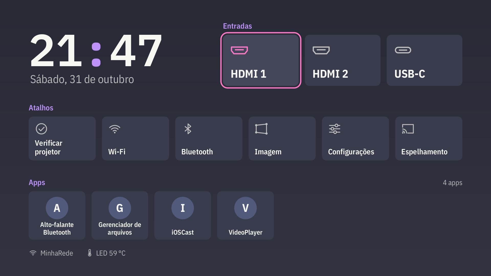
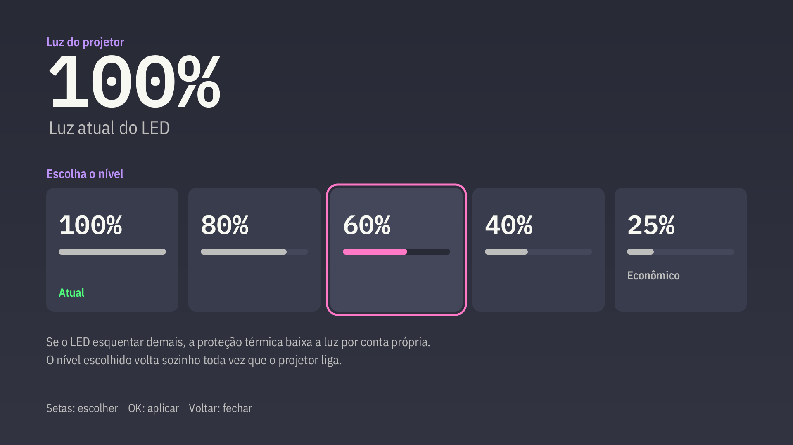

# Home PFL7560 (`com.pfl7560.home`, bloco 10A)

Tela inicial nova para o projetor, na paleta Drácula do bloco 10: relógio e data, **Entradas** (HDMI 1,
HDMI 2 e, no modelo que tem, USB-C), **Atalhos** (Verificar projetor, Wi-Fi, Bluetooth, Imagem, Luz, Configurações),
**Apps** e uma linha de estado (rede e temperatura do LED). Só D-pad, com o foco em rosa. Pesquisa, intents,
riscos e desenho: [doc 45](../../docs/research/45-home-pfl7560.md).

## Luz (bloco 15)

O atalho **Luz** mostra o valor atual por baixo ("100%") e, com OK, abre o painel "Luz do projetor" com 5
níveis (100, 80, 60, 40 e 25 "Econômico"). Setas escolhem, OK aplica, BACK fecha. O app não fala com o
`hidebug` (só roda como root): grava o número, só dígitos, no arquivo `luz` da pasta privada dele
(`getDataDir()`), e o vigia root do kit (`suite-pedido.sh`) aplica com `sbl N`, confere com `gbl` e devolve o
valor na prop `vendor.pfl7560.luz` (lida de volta pelo app com `getprop`). O nível escolhido fica guardado pelo kit e é reaplicado em todo
boot (`suite-boot.sh`). Doc 44 (vigia) e doc 45 (home).

## Sem Espelhamento nem os apps desligados (bloco 16B)

O atalho Espelhamento saiu e a fileira Apps nunca mostra o Office, o iOSCast nem o Espelhamento (`Modelo.OCULTOS`),
que o dono mandou desligar. Doc 45 §12.

## Ligar e desligar

A home de fábrica continua instalada. A nossa vira a tela inicial pela linha
`vendor.newlink.launcher.package=com.pfl7560.home` no `/vendor/build.prop`, que o kit do pendrive grava só com
a home instalada e conferida: o `nlprovision` (a HOME de fábrica) continua fazendo o trabalho de boot e repassa
para a nossa (doc 45 §4.2, caminho B). O `cmd package set-home-activity` **não serve** aqui: o `nlprovision` tem
prioridade 29 no filtro HOME e vence (visto no aparelho em 2026-10-31). Para voltar à de fábrica: o
`DESINSTALAR-SUITE.txt` no pendrive (tira a linha) ou tirar a linha à mão; vale no boot seguinte.

Para abrir sem trocar a padrão: `adb shell am start -n com.pfl7560.home/.HomeActivity`.

## Compilar

    bash artifacts/home/build.sh          # APK do zero: artifacts/home/pfl7560-home.apk
    bash artifacts/home/gerar-previas.sh  # prévias 1920x1080 em artifacts/home/previa/

O molde é o do `artifacts/app/`: sem Gradle, com o SDK local (`ANDROID_SDK`, padrão `~/Android/sdk`;
`BUILD_TOOLS` 35.0.0; `PLATAFORMA` android-34), Java 17 (`javac --release 8`), `zip` e `apksigner`. O
`build.sh` confere a paleta (`artifacts/tema/dracula.txt` × `colors.xml` × `Tema.java`), copia as fontes IBM Plex do kit para
`assets/fontes/` e assina com `assinatura.keystore` (PKCS12, alias `pfl7560home`, senha no script). A chave
não é segredo: só garante que um APK novo instale por cima. O resultado é determinístico. O script **não**
copia nada para o kit (`pendrive-autorun/`); a integração é do coordenador.

`minSdk 28`, `targetSdk 28`, `versionCode 5`. Permissões: `ACCESS_NETWORK_STATE` e `ACCESS_WIFI_STATE`,
ambas normais.

## Código

| Arquivo | Papel |
|---|---|
| `src/.../Desenho.java`, `Icones.java`, `Modelo.java`, `Tema.java`, `Item.java`, `Acoes.java`, `Pintor.java` | Java puro: layout, ícones, estado e navegação do D-pad. O mesmo código no aparelho e nas prévias |
| `src/.../PintorCanvas.java`, `HomeView.java`, `HomeActivity.java` | Android: Canvas, foco e teclas, ciclo de vida |
| `src/.../Abridor.java` | intents de cada cartão (fontes no doc 45 §3) |
| `src/.../Leitor.java` | lista de apps (só rótulo e pacote: o ícone de cada app é desenhado em `Icones.java`, nunca o `loadIcon`), rede e temperatura, fora da thread da interface |
| `src/.../Guarda.java` | trava anti-laço: duas quedas em 2 min entregam a tela à home de fábrica |
| `previa-src/.../PintorJ2D.java`, `Previa.java` | pintor Java2D e gerador das prévias, só no PC |

Instalação no aparelho: como o app do 9C, só como app do sistema em `/vendor/app/PFL7560Home/PFL7560Home.apk`
(o `pm install` deste firmware recusa apps de fora). O kit do pendrive faz isso (`KIT_APPS` no
`newlink_update.sh`). Em uso no projetor do dono desde 2026-10-31.
