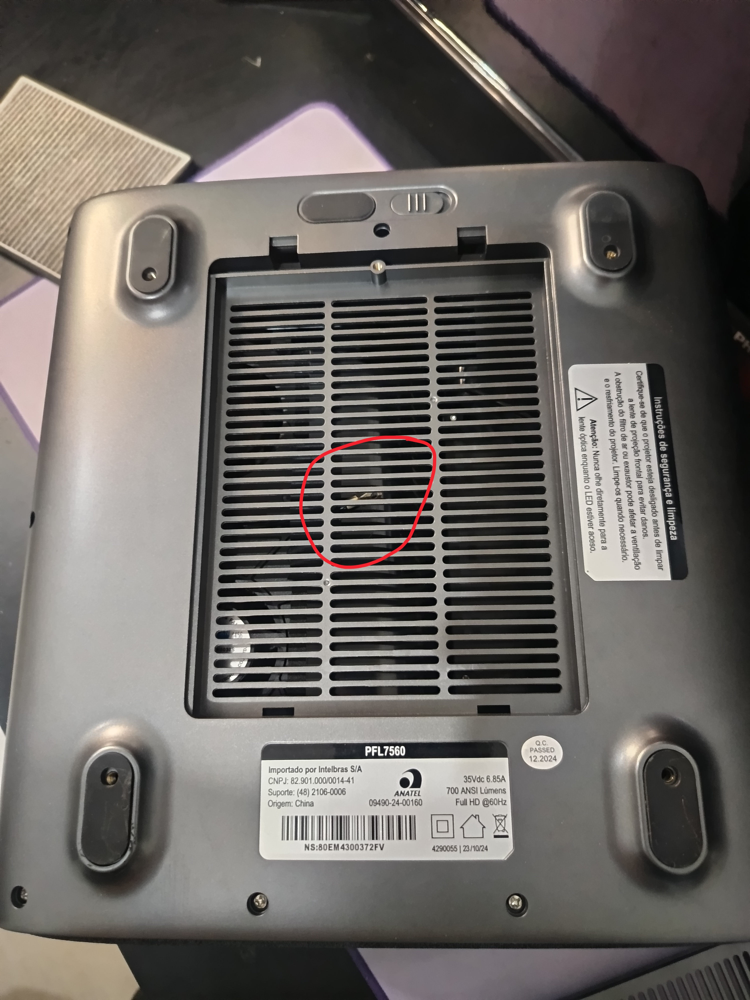
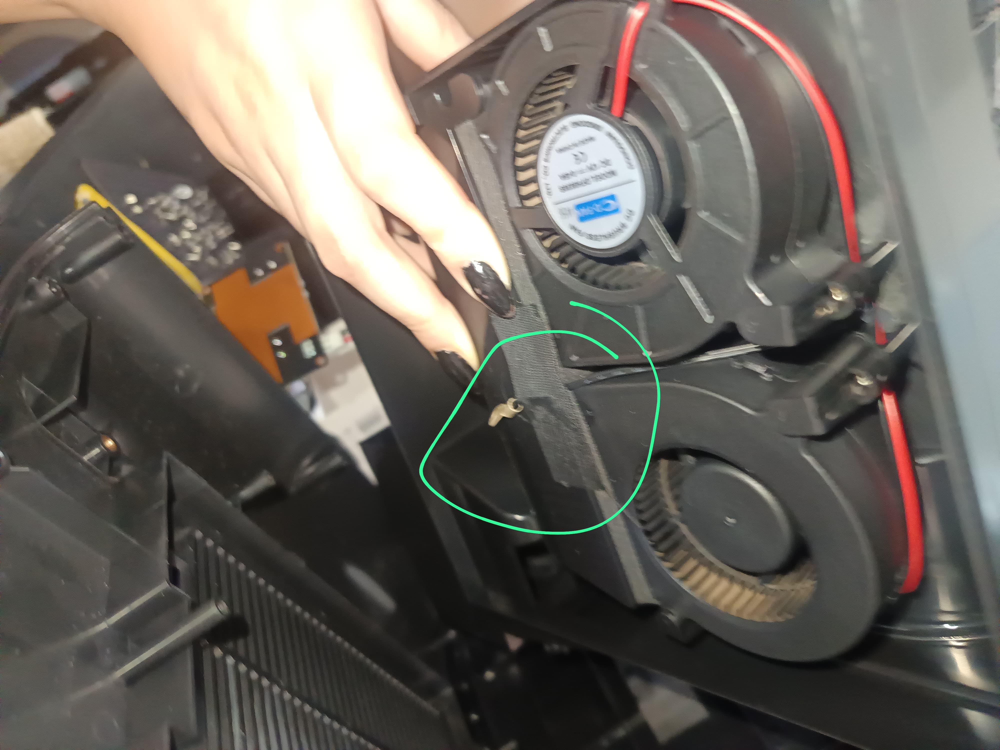
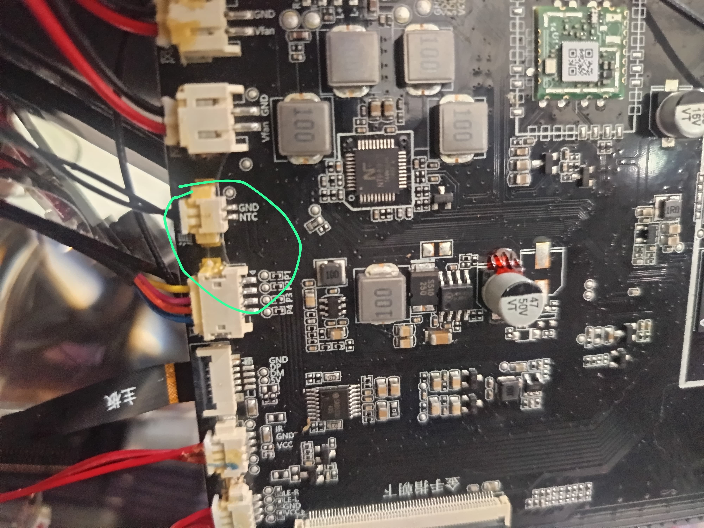
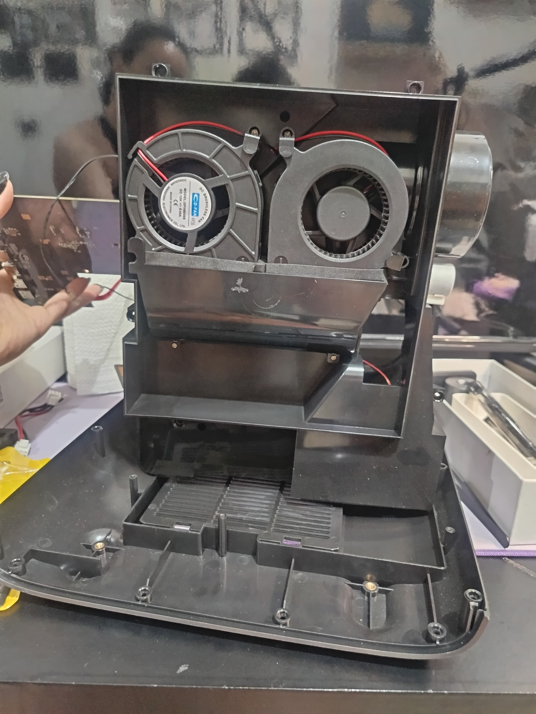
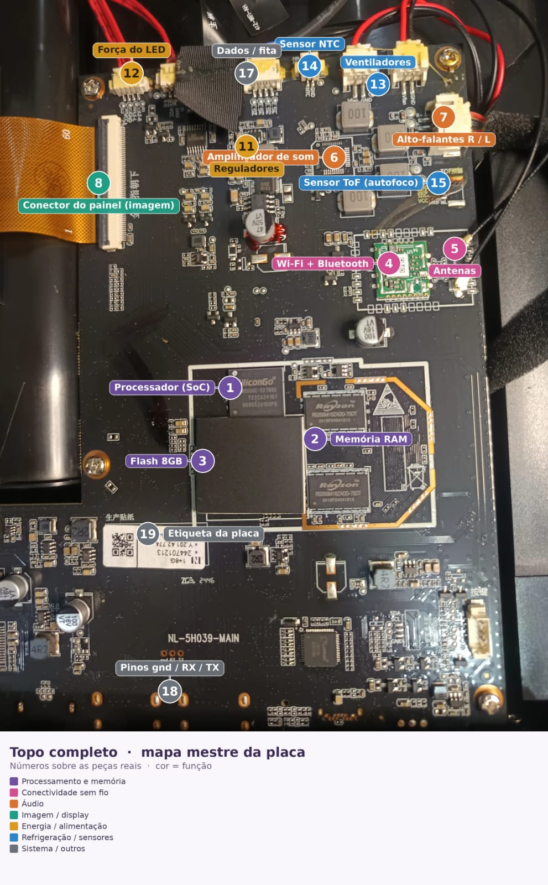
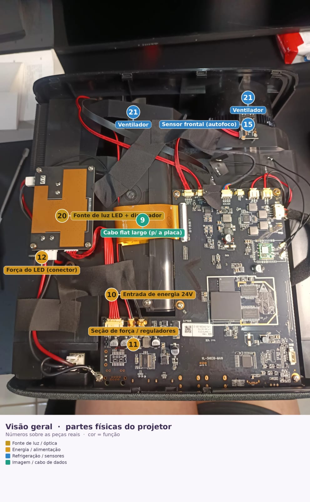

# 27 - Teardown, cabo GND/NTC e correção do mapa da placa

Registro do teardown fotografado de **2026-07-09/10**, com identificação do cabo que "sempre ficou
solto" e correção do mapa da placa feito anteriormente. Versão visual: [`docs/dossie-teardown.html`](../dossie-teardown.html).

> **Higiene:** a foto `media/teardown-01-base-cabo-solto.jpg` mostra o **número de série** do aparelho
> na etiqueta. Borre antes de qualquer publicação externa se quiser anonimizar o exemplar.

## TL;DR

- O cabo solto é o **aterramento (bond de chassi/EMI) do header `GND/NTC`** — **não** o terra funcional do sensor de temperatura. **Não afeta a leitura térmica.**
- Refrigeração confirmada: **2 sopradores COFN DFH8025S** (DC 12 V), batendo com o firmware (`CoolingFan = 2`).
  **Corrigido em 2026-10-29:** são **3 ventiladores** — os 2 sopradores **D-FAN `DFH8030S`** (12 V, 0,45 A)
  que a política controla e 1 axial no exaustor do dissipador do LED, sem controle (OPT-S6 fechado,
  [doc 40](40-sessao-2026-10-29-segunda-troca-lcd-e-auditoria.md) §3).

> **CORREÇÃO (2026-10-29) — dois olhais diferentes, não confundir.** Este doc trata do **olhal solto**
> entre os sopradores (foto `teardown-03`). O fio que sai do conector `NTC GND` da placa principal é outro:
> **dois fios finos trançados** que terminam num **olhal de latão parafusado no topo do bloco dissipador
> do LED**, com o tubo selado com resina — é o **NTC do `gtt1`**, encapsulado em terminal de anel
> (OPT-S7 fechado, [doc 40](40-sessao-2026-10-29-segunda-troca-lcd-e-auditoria.md) §3). Portanto o
> argumento 1 abaixo ("terminal de anel é ferragem, não sensor") **não vale como regra**: NTC encapsulado
> em terminal de anel é formato comum. A classificação do olhal **solto** como aterramento não foi
> derrubada; a do olhal **parafusado no bloco do LED** é de sensor.
- **Correção crítica do mapa:** o SoC e o Flash estavam **trocados**. `SiliconGo T22CA2415T` é um controlador de armazenamento; o SoC HiSilicon Hi3751V553 é o chip grande sob espalhador de calor.

## O cabo solto — análise

O dono notou um cabo com terminal de anel (olhal) pendurado no interior, "sempre solto". Uma ponta é
fixa no header serigrafado **`GND / NTC`** da placa; a outra é o olhal, que estava solto no fundo, preso
com fita isolante.

**Conclusão: é um jumper de aterramento / EMI**, não o retorno de sinal do termistor. Três evidências convergem:

1. **Geometria.** O terra funcional do NTC entra pelo conector de 2 vias **plugado** no header `GND/NTC`
   (foto abaixo). Um terminal de anel é ferragem para parafusar em metal — não entra numa carcaça JST.
2. **Assinatura elétrica.** Quando o terra do NTC abre, o firmware registra `LSADC Error` + valor absurdo
   e rejeita a amostra. Esse padrão aparece **uma vez** (glitch) no `heat.logcat` do stock; todas as
   leituras usadas na pesquisa são `Achieve Balance` (válidas) → o terra funcional esteve íntegro.
3. **Sentido do viés.** Um terra com mau contato soma resistência em série, atribuída ao termistor →
   leitura puxada para **mais frio**. Logo os 65,8 °C medidos no fix são um **piso**, não inflação.

**O que fazer:** opcional. Reparafusar o olhal num ponto de terra metálico melhora EMI/aterramento; se
não houver ponto claro, deixar como está não causa problema de temperatura nem de imagem. Sem multímetro,
dá para confirmar via adb: ler `gtt 0/1` antes e depois de reconectar — a expectativa é não mudar nada.

## Refrigeração — 2 sopradores DFH8025S (corrigido: 3 ventiladores, ver abaixo)

Dois blowers COFN **DFH8025S** (DC 12 V), exatamente o que a config térmica declara
(`[CoolingFan] SERIAL_NUM = 2`). **Não há Peltier/TEC nem terceiro ventilador** — a refrigeração é
passiva (dissipador) + ar forçado (2 sopradores) + proteção por dimming/desligamento do LED.

> **CORREÇÃO (2026-09-03) — dois pontos deste parágrafo estão errados ou incompletos:**
>
> 1. **Existe um TERCEIRO ventilador.** Com o aparelho aberto na bancada (2026-09-02), foi observado que
>    o **LED tem fan axial próprio**, com dissipador aletado, separado dos dois blowers
>    ([doc 38](38-motor-optico-e-troca-do-polarizador.md) §1). O `SERIAL_NUM = 2` conta só os que a
>    política térmica controla — não é o total físico. **Contagem final ainda não fechada: OPT-S6.**
>    **FECHADO (2026-10-29):** são 3, os 2 sopradores e 1 no exaustor do LED, os três funcionando
>    ([doc 40](40-sessao-2026-10-29-segunda-troca-lcd-e-auditoria.md) §3).
> 2. **O modelo provavelmente é `DFH8030S`** (30 mm de espessura), não `DFH8025S`. Etiqueta lida em foto
>    ampliada: `DC 12V / 0,45 A`. Confirmação na etiqueta física pendente (**OPT-S5**).
>    **FECHADO (2026-10-29):** `DFH8030S`, 12 V, 0,45 A, centrífugo, `PROVADO` pela etiqueta
>    ([doc 40](40-sessao-2026-10-29-segunda-troca-lcd-e-auditoria.md) §4); a marca é D-FAN, não COFN
>    ([doc 39](39-sessao-2026-09-02-optica-e-balanco-termico.md) §2.2).
>
> Consequência: qualquer conta de vazão ou redirecionamento de ar feita com "2 ventiladores" parte de um
> mapa térmico errado. Ver [doc 39](39-sessao-2026-09-02-optica-e-balanco-termico.md) §2.3.

> **Ressalva (doc 34, 2026-07-29):** ampliando a mesma foto, a etiqueta **parece dizer `DFH8030S`**, não
> `DFH8025S`. O dígito não foi resolvido na resolução disponível — **confirmar na etiqueta física** antes
> de dar o modelo por fechado. Só importa para spec de RPM num eventual swap. (Fechado em 2026-10-29:
> `DFH8030S`, ver a correção acima.)

## Correção do mapa da placa

O mapa anterior (feito por IA numa sessão passada) tinha erros. Correções:

| # | Antes | Correto |
|---|---|---|
| 1 / 3 | "SoC" no chip `SiliconGo T22CA2415T` | **1 = SoC HiSilicon Hi3751V553** (chip grande, sob espalhador); **3 = Flash eMMC 8 GB** (o SiliconGo é o controlador de storage) |
| 10 | "Entrada 24 V" | **~35 Vdc / 6,85 A** (etiqueta do produto) |
| 2 | "RAM" | correto — **1 GB** (2× Rayson RS256M16ZADD) |
| 13 / 21 | "3 ventiladores" | **2 ventiladores** DFH8025S. **Corrigido (2026-10-29):** o mapa anterior estava certo, são **3** (2 sopradores DFH8030S + 1 axial no exaustor do LED, OPT-S6) |
| 14 | — | **Header GND/NTC** (2 termistores ZL103SAF muxados pelo BL1551B @ GPIO4_4). O NTC do `gtt1` chega por fio ao olhal no topo do bloco do LED (OPT-S7, doc 40 §3) |

## Integridade da tese

A descoberta do GND solto foi auditada de forma adversarial (ver histórico da sessão): a tese central —
o **2º sensor cego pelo mux** (`HW_VIRTUAL_CHANNEL=0` nos dois termistores no stock) — **permanece
intacta e sai reforçada**. A prova do mux depende do canal virtual, não do estado do terra; e a própria
assinatura elétrica dos dados (leituras finitas, válidas, divergentes) exclui "GND ruim" como explicação
alternativa. Persistência do fix confirmada em [`26-persistencia-do-fix.md`](26-persistencia-do-fix.md).
